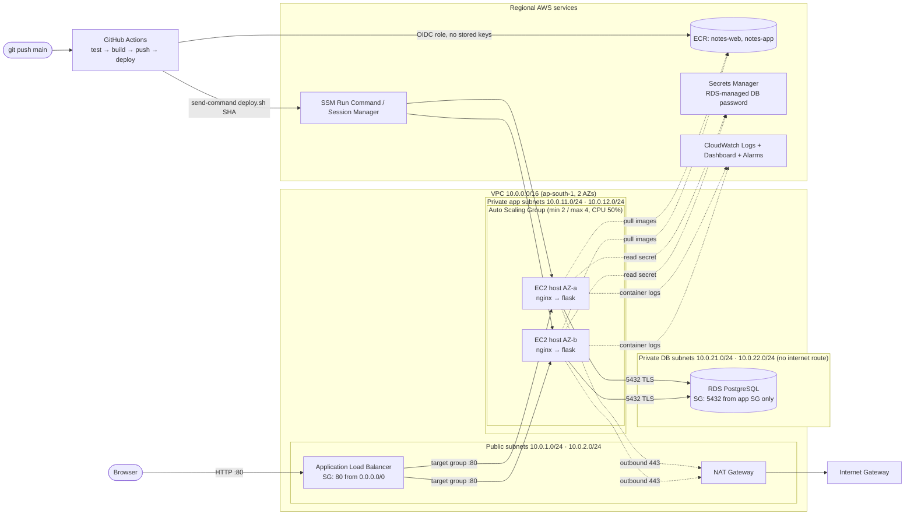

# Cloud Notes — Three-Tier Web App on AWS

SE-490 Cloud Computing CEA. A notes app deployed as a containerised three-tier system on AWS,
with infrastructure as code (Terraform) and a GitHub Actions CI/CD pipeline.

| Tier | Technology | Where it runs |
|---|---|---|
| Web | Nginx (non-root) serving the UI and reverse-proxying `/api` | Docker container on EC2 hosts in **private** subnets, behind a public **ALB** |
| Application | Python Flask REST API (Gunicorn) | Docker container on the same hosts; reachable **only** from the web container |
| Database | Amazon RDS for PostgreSQL 16 | Isolated **private DB subnets** with no internet route, TLS enforced |

## Architecture



**Security boundaries:** `Internet → ALB SG (80) → App-host SG (80 from ALB SG only) → DB SG (5432 from App SG only)`.
There is no SSH anywhere; admin shell access goes through SSM Session Manager.

## Repository layout

```
app/                    Application tier (Flask API, Dockerfile, pytest tests)
web/                    Web tier (Nginx config, Dockerfile, static UI)
docker-compose.yml      Runs web+app on each EC2 host (production)
docker-compose.override.yml   Local-only: builds images + local Postgres
infra/                  Terraform: VPC, subnets, NAT, SGs, ALB, ASG, RDS, ECR, IAM, CloudWatch
  templates/user_data.sh.tftpl   EC2 bootstrap (Docker, CloudWatch logging, first deploy)
  templates/deploy.sh            Pull + restart containers at a given image tag
.github/workflows/deploy.yml     CI/CD pipeline
```

---

## Step-by-step guide

### 0. Install tools (Ubuntu)

```bash
# Docker
curl -fsSL https://get.docker.com | sudo sh
sudo usermod -aG docker $USER && newgrp docker

# AWS CLI v2
curl -fsSL "https://awscli.amazonaws.com/awscli-exe-linux-x86_64.zip" -o awscliv2.zip
unzip -q awscliv2.zip && sudo ./aws/install && rm -rf aws awscliv2.zip
#   (no sudo? install into your home folder instead:
#    ./aws/install -i ~/.local/aws-cli -b ~/.local/bin)

# Terraform
wget -O- https://apt.releases.hashicorp.com/gpg | sudo gpg --dearmor -o /usr/share/keyrings/hashicorp-archive-keyring.gpg
echo "deb [signed-by=/usr/share/keyrings/hashicorp-archive-keyring.gpg] https://apt.releases.hashicorp.com $(lsb_release -cs) main" | sudo tee /etc/apt/sources.list.d/hashicorp.list
sudo apt update && sudo apt install -y terraform

# GitHub CLI is already installed; log in once:
gh auth login
```

### 1. AWS account setup (one-time)

1. In the AWS console, go to **IAM → Users → Create user** (e.g. `terraform-admin`) and attach
   `AdministratorAccess`. Don't use the root account.
2. Open that user, go to **Security credentials → Create access key → CLI**, then run:
   ```bash
   aws configure            # paste the keys, region: ap-south-1, output: json
   aws sts get-caller-identity   # check it works
   ```
   These keys stay on your laptop only. The pipeline never uses them; it uses OIDC.
3. **Set a budget alert:** go to **Billing → Budgets → Create budget → "Zero spend"** or a $10 monthly budget.

### 2. Run it locally first

```bash
docker compose up --build
# open http://localhost  → add / edit / delete notes
docker compose down        # add -v to wipe the local DB
```

### 3. Create the GitHub repository (don't push yet)

```bash
git init -b main
git add . && git commit -m "Initial commit: three-tier notes app"
gh repo create cloud-notes --public --source=. --remote=origin
```

### 4. Provision the infrastructure

```bash
cd infra
cp terraform.tfvars.example terraform.tfvars
#   edit terraform.tfvars → github_repo = "<your-github-username>/cloud-notes"
terraform init
terraform plan
terraform apply          # ~10-15 min (RDS is the slow part)
```

If you get *"Provider with url https://token.actions.githubusercontent.com already exists"*, set
`create_github_oidc_provider = false` in `terraform.tfvars` and apply again.

### 5. Connect the pipeline to AWS, then push

```bash
terraform output -raw github_setup_commands | bash   # sets the GitHub secret + variables
cd ..
git push -u origin main
```

Watch it with `gh run watch`, or in the repo's **Actions** tab. The pipeline runs these jobs:

1. **Test:** pytest against a real PostgreSQL service container, compose validation, and an image build.
2. **Build & push:** both images go to ECR, tagged `<commit-sha>` and `latest`.
3. **Deploy:** SSM Run Command runs `/opt/notes/deploy.sh <sha>` on every in-service instance,
   then a smoke test hits `/api/health`, `/api/ready` and `/api/info` through the ALB.

Then open the URL:

```bash
terraform -chdir=infra output app_url
```

The footer shows which **instance and AZ** served the request and which **commit** is live.
Refresh a few times and the instance ID changes, which shows the load balancer at work.

> On a fresh environment the EC2 hosts boot before any image exists. They retry the first
> deploy for up to 20 minutes, and the pipeline's deploy job also pushes to them, so just push
> soon after `terraform apply`.

### 6. Prove automated deployment (for the report)

Edit something visible, e.g. the `<h1>` in `web/html/index.html`, then:

```bash
git commit -am "Change heading" && git push
```

When the pipeline goes green, refresh the site: the new heading appears and the footer version
matches the new commit SHA.

### 7. Prove elasticity (optional, good for the report)

```bash
# Load the CPU on all hosts for 10 minutes through SSM (no SSH needed)
IDS=$(aws autoscaling describe-auto-scaling-groups --auto-scaling-group-names notes-asg \
  --query "AutoScalingGroups[0].Instances[].InstanceId" --output text)
aws ssm send-command --instance-ids $IDS --document-name AWS-RunShellScript \
  --parameters '{"commands":["timeout 600 yes > /dev/null & timeout 600 yes > /dev/null & wait"]}'
```

Watch **CloudWatch → Dashboards → notes-overview**, and **EC2 → Auto Scaling Groups → notes-asg → Activity**.
CPU passes 50%, the group scales out to 3–4 instances, then scales back in after the load stops.

### 8. Tear down (do this when you're done)

```bash
terraform -chdir=infra destroy
```

You can recreate everything later with `terraform apply` if you need more screenshots.

---

## Screenshot checklist (deliverable 2)

| Required evidence | Where to capture it |
|---|---|
| VPC and subnets | VPC → Your VPCs → `notes-vpc` → **Resource map** tab (shows subnets, route tables, IGW, NAT in one picture) |
| Compute / container hosts | EC2 → Instances (2 × `notes-host`, different AZs, **no public IP**); EC2 → Auto Scaling Groups → `notes-asg` |
| Security groups | EC2 → Security Groups → inbound rules of `notes-alb-sg`, `notes-app-sg`, `notes-db-sg` |
| Load balancer | EC2 → Load Balancers → `notes-alb` (listeners); Target Groups → `notes-tg` → **Targets** (healthy) |
| Database | RDS → `notes-db` → Connectivity & security (**Publicly accessible: No**, private subnets) |
| Docker build and registry | GitHub Actions build-push logs; ECR → `notes-web` / `notes-app` image list with SHA tags and scan results |
| CI/CD run | GitHub → Actions → a green run showing Test → Build & push → Deploy |
| Running app | Browser on the ALB URL, footer visible |
| Extras | Secrets Manager secret; CloudWatch log group `/notes/containers`; dashboard `notes-overview`; `terraform apply` output |

---

## Requirement coverage

| # | Requirement | Implementation |
|---|---|---|
| 1 | Network | `infra/network.tf`: VPC, 2× public / 2× private-app / 2× private-DB subnets, IGW, NAT, 3 route tables, S3 gateway endpoint |
| 2 | Web tier | `web/Dockerfile`: Nginx (unprivileged), public through the ALB |
| 3 | App tier | `app/Dockerfile`: Flask + Gunicorn, `docker-compose.yml`; private subnets, reachable only from Nginx |
| 4 | Database | `infra/database.tf`: RDS PostgreSQL, not publicly accessible, TLS forced, encrypted at rest |
| 5 | Registry | `infra/ecr.tf`: ECR with scan-on-push and lifecycle policy |
| 6 | CI/CD | `.github/workflows/deploy.yml`: test → build/push → deploy (SSM) → smoke test |
| 7 | LB and scaling | `infra/alb.tf`, `infra/compute.tf`: ALB, target group, ASG across 2 AZs, CPU target tracking |
| 8 | Security | Per-tier SGs chained by SG reference; segmented subnets; least-privilege IAM; RDS-managed secret in Secrets Manager; GitHub OIDC (no AWS keys in GitHub); IMDSv2; non-root, read-only containers; no SSH |
| 9 | Enhancements | **Terraform IaC**, **CloudWatch** centralised logging, dashboard and alarms, plus a **cost estimate** (below) |

## Cost estimate (ap-south-1, on-demand, approximate; check with the [AWS Pricing Calculator](https://calculator.aws/))

| Item | ≈ USD / month (24×7) |
|---|---|
| NAT Gateway (hourly + its public IPv4) | ~45 |
| Application Load Balancer (hourly + 2 public IPv4 + low LCU) | ~26 |
| 2 × EC2 t3.micro + 2 × 8 GB gp3 | ~18 |
| RDS db.t3.micro PostgreSQL, single-AZ, 20 GB gp2 | ~17 |
| Secrets Manager (1 secret), CloudWatch (logs, dashboard, alarms), ECR storage | ~2 |
| **Total** | **≈ $105 / month ≈ $3.5 / day** |

New AWS accounts (created after July 2025) get free-tier **credits** that cover a few days of
this comfortably. On older accounts, EC2 and RDS micro hours are free but NAT and ALB are billed.
Either way, **run `terraform destroy` when you're done.**

**Cost optimisations to propose:**
1. Replace the NAT Gateway with a NAT instance (t4g.nano, about $3/month): the biggest single saving, at some cost to availability.
2. Move to Graviton (`t4g.micro` / `db.t4g.micro`): about 20% cheaper for the same performance.
3. Scheduled scaling: run `min = 1` outside working hours, and stop RDS when not in use.
4. A Compute Savings Plan or Reserved Instances for the always-on baseline: up to about 40–60% off.
5. Already in place: S3 gateway endpoint (free, cuts NAT data charges), ECR lifecycle policy, 7-day log retention.

## Known limitations (be honest about these in the NFR section)

- **HTTP only:** no domain or ACM certificate, so traffic to the ALB is unencrypted. *Fix:* Route 53 domain, ACM certificate, HTTPS listener with HTTP→HTTPS redirect.
- **Single-AZ RDS and a single NAT Gateway:** cost-driven single points of failure. *Fix:* `db_multi_az = true`, one NAT per AZ.
- **App connects as the RDS master user:** *Fix:* a dedicated DB role with only SELECT/INSERT/UPDATE/DELETE on `notes`.
- **One DB connection per request:** fine at this scale. *Fix:* connection pooling (psycopg_pool) or RDS Proxy.
- **Local Terraform state:** *Fix:* S3 backend with state locking.
- **No WAF or caching:** *Fix:* AWS WAF on the ALB, CloudFront in front for static assets.
